## operaciones basicas con open cv
## alumno jose solis NC 1472
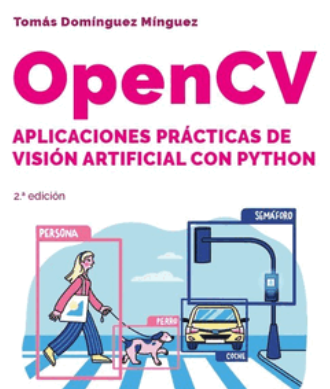

## 1. LECTURA DE LA IMAGEN DESDE LA CARPETA
#### cuando no puede leer la imagen 
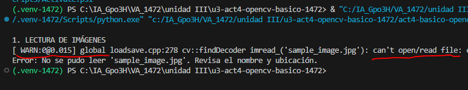
#### cuando puede leer la imagen
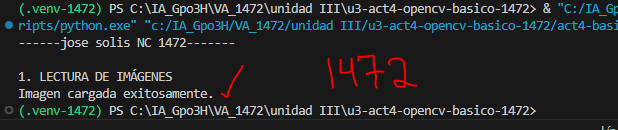
## 2. PROPIEDADES DE LA IMAGEN

## 3. mostrandso imagen originial

## 4. modificando pixeles
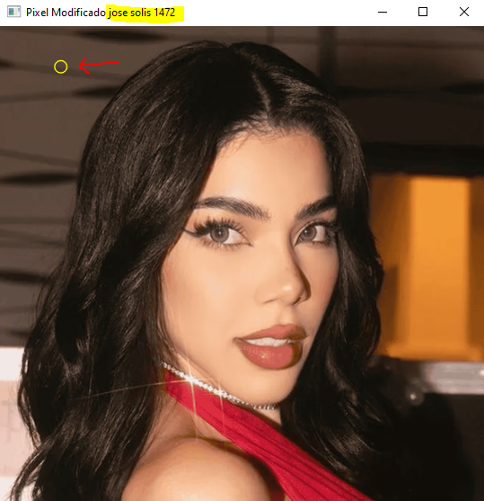

## en la terminal
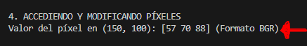

## 5. REGIÓN DE INTERÉS (ROI - REGION OF INTEREST)
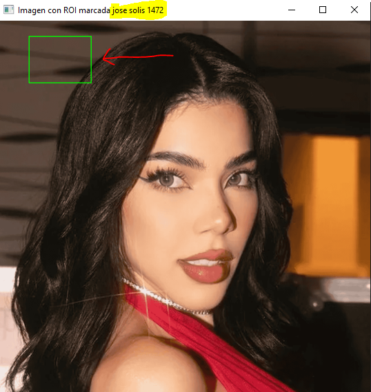
## 6. SEPARACIÓN Y FUSIÓN DE CANALES DE COLOR (BGR)
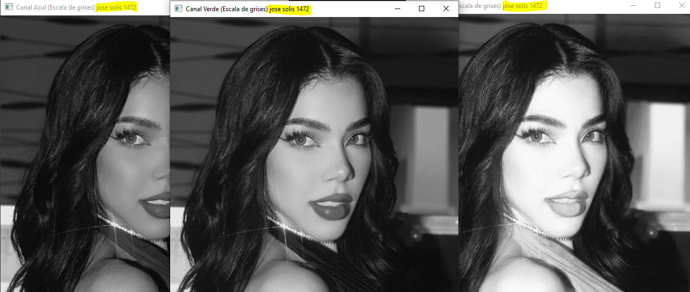
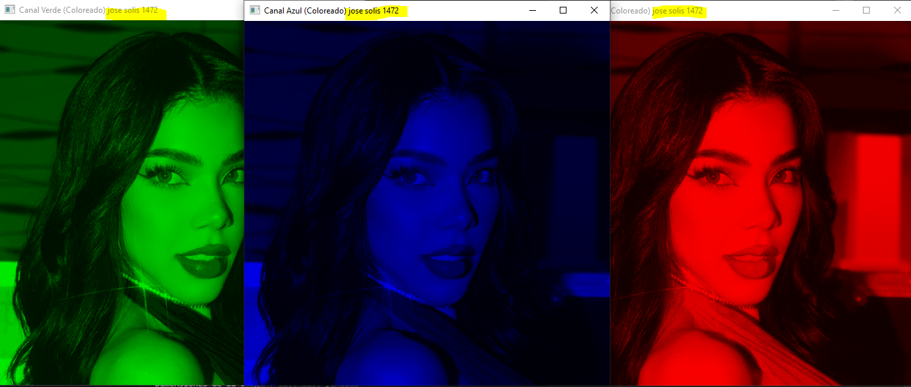

## 7. REDIMENSIONAMIENTO DE IMÁGENES (RESIZING)
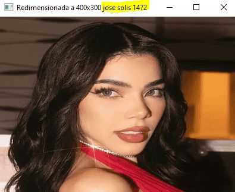
## 8. ROTACIÓN DE IMÁGENES
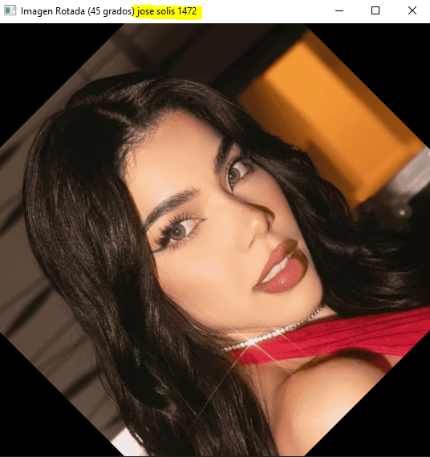

## 9. VOLTEO / ESPEJO DE IMÁGENES (FLIPPING)
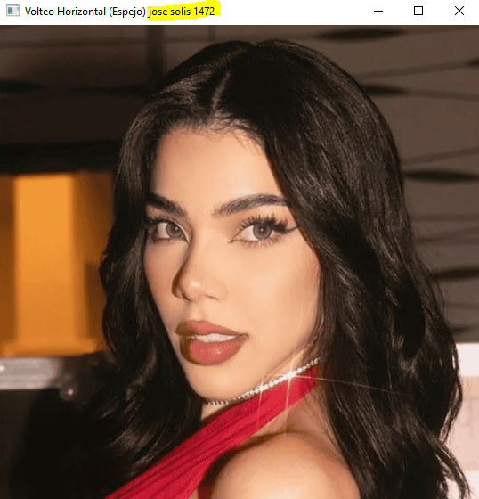
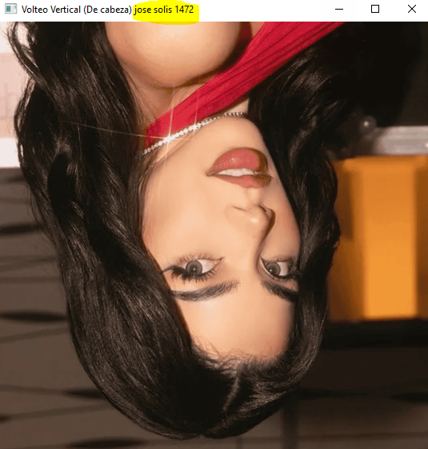
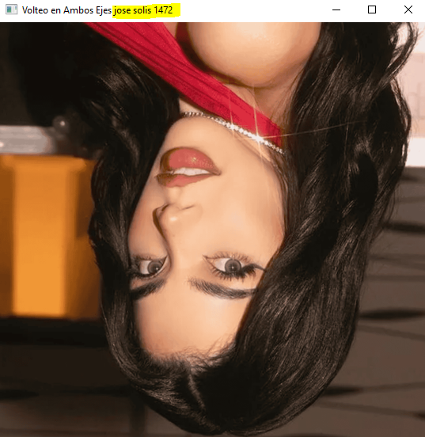
## 10. GUARDADO DE RESULTADOS Y LIMPIEZA
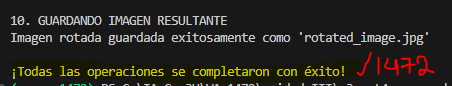
