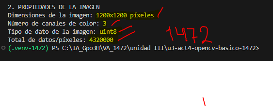

## operaciones basicas con open cv
## alumno jose solis NC 1472

## 1. LECTURA DE LA IMAGEN DESDE LA CARPETA
#### cuando no puede leer la imagen 

#### cuando puede leer la imagen

## 2. PROPIEDADES DE LA IMAGEN

